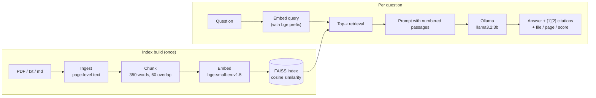

# FinLens: Local Retrieval-Augmented QA over Financial Filings

Ask questions about annual reports and results announcements and get answers with page-level citations. **The whole pipeline runs on your machine**: local embeddings (sentence-transformers), local vector search (FAISS) and a local LLM served by Ollama. There are no API keys, no cloud calls and no training; only pre-trained models are used.

Built and evaluated on 11 London Stock Exchange Group (LSEG) filings, about 1,100 pages in total.

---

## Table of Contents
- [How it works](#how-it-works)
- [Project structure](#project-structure)
- [Configuration](#configuration)
- [Setup](#setup)
- [Usage](#usage)
- [Evaluation](#evaluation)
- [Design decisions](#design-decisions)
- [Limitations & future work](#limitations--future-work)
- [Hosting](#hosting)
- [Troubleshooting](#troubleshooting)
- [Author](#author)

---

## How it works



1. **Ingest:** PDFs are read page by page with `pypdf`. Hyphenated line breaks are re-joined, and blank or image-only pages are skipped with a warning.
2. **Chunk:** each page is split into overlapping word windows. Every chunk keeps its source file and page number so citations stay exact.
3. **Embed and index:** chunks are embedded with `BAAI/bge-small-en-v1.5`, L2-normalised and stored in a FAISS inner-product index. Inner product on unit vectors is cosine similarity.
4. **Retrieve:** the question is embedded with the bge query prefix and the top-k chunks are returned.
5. **Generate:** the chunks are passed to a local LLM that is instructed to answer **only** from the numbered passages, cite them, quote figures exactly and refuse when the answer is not present. Temperature is 0.

---

## Project structure

```
fin-rag/
├── rag/
│   ├── config.py       # all tunables: models, chunk size, top-k, paths
│   ├── ingest.py       # PDF / text -> page-level records
│   ├── chunking.py     # overlapping word-window chunker
│   ├── embedder.py     # sentence-transformers wrapper (lazy-loaded)
│   ├── index.py        # FAISS index: build / save / load / search
│   ├── retriever.py    # question -> top-k chunks
│   ├── generator.py    # prompt construction + Ollama chat call
│   └── pipeline.py     # retrieval + generation, shared by CLI and UI
├── build_index.py      # build the index from data/raw
├── ask.py              # terminal Q&A (interactive or one-shot)
├── app.py              # Streamlit web UI
├── evaluate.py         # hit@k / MRR, chunk-size sweep
├── eval/questions.json # 20 hand-labelled questions
└── scripts/download_docs.sh
```

---

## Configuration

Everything lives in [`rag/config.py`](rag/config.py).

| Setting | Default | Notes |
|---|---|---|
| `EMBED_MODEL` | `BAAI/bge-small-en-v1.5` | about 130 MB. Changing it requires a rebuild |
| `CHUNK_WORDS` / `CHUNK_OVERLAP` | 350 / 60 | override with `--chunk-words`, `--overlap` |
| `MIN_CHUNK_WORDS` | 30 | drops headers and page-number fragments |
| `TOP_K` | 5 | passages given to the LLM |
| `OLLAMA_MODEL` | `llama3.2:3b` | `qwen2.5:3b` and `llama3.1:8b` also work |
| `OLLAMA_NUM_CTX` | 4096 | must fit `TOP_K` chunks plus the question |

---

## Setup

**Requirements:** Python 3.10+, [Ollama](https://ollama.com/download), about 3 GB of disk and 4-8 GB of RAM. A GPU is optional; on CPU expect roughly 5-30 s per answer with a 3B model.

```bash
git clone <this-repo> && cd fin-rag
python3 -m venv .venv && source .venv/bin/activate

# Optional on machines without a GPU: small CPU-only PyTorch build
pip install torch --index-url https://download.pytorch.org/whl/cpu

pip install -r requirements.txt
ollama pull llama3.2:3b
```

Get documents into `data/raw/`. Either run the bundled script for the LSEG filings, or drop in any text-based PDF, `.txt` or `.md` file:

```bash
bash scripts/download_docs.sh
python build_index.py            # about 2 min on CPU for ~1,100 pages
```

The first run downloads the embedding model once. Scanned PDFs without a text layer are skipped.

---

## Usage

```bash
python ask.py                                                # interactive
python ask.py -q "What final dividend was proposed for 2025?"
python ask.py -q "..." --retrieve-only                       # search only, no LLM
streamlit run app.py                                         # web UI on :8501
```

Example (llama3.2:3b, top-5):

```
Q: What dividend per share was proposed for 2025?
A: ... the final dividend for the year ended 31 December 2025 is 103.0p per share [4][5].

SOURCES
  [4] lseg-2025-preliminary-results-rns-26feb2026.pdf, p.13  (score 0.727)
  [5] lseg-annual-report-2025.pdf, p.32                      (score 0.719)
```

---

## Evaluation

Retrieval quality is measured on **20 hand-written questions** in [`eval/questions.json`](eval/questions.json). Each has a verified answer, the source file, the page range and a keyword. A retrieved chunk counts as relevant if it comes from the labelled page *or* contains the keyword.

Setup: 11 LSEG PDFs (annual reports 2018 / 2019 / 2020 / 2025, 2025 preliminary results RNS, presentation and transcript, H1 2026 interim report, presentation and transcript, sustainability report), default chunking, `bge-small-en-v1.5`, FAISS cosine search.

```bash
python evaluate.py                        # metrics + list of misses
python evaluate.py --sweep 150,300,500    # compare chunk sizes
```

| Metric | Score |
|---|---|
| hit@1 | 0.25 |
| hit@3 | 0.60 |
| hit@5 | **0.75** |
| MRR | 0.45 |

### Failure analysis (5 of 20 questions missed in the top 5)

| Question | Cause |
|---|---|
| 2025 total income excl. recoveries (£8,986m) | Narrative pages of the annual report outranked the table in the results RNS |
| Final dividend proposed for 2019 (49.9p) | Dividend passages from other years ranked higher |
| Total dividend in the 2020 annual report (75.0p) | Same: year is not captured by the embeddings |
| Acquisition completed January 2021 (Refinitiv) | Other Refinitiv passages ranked higher; the keyword may also straddle a chunk boundary |
| Number of employees (26,000+) | Employee sections from older reports ranked higher |

The misses cluster around **year-specific questions** (the same topics repeat in every annual report) and **numbers in tables**, which PDF text extraction handles poorly. Generation quality was spot-checked, not scored; the evaluation covers retrieval only.

---

## Design decisions

- **Page-level provenance.** Every chunk carries `(source, page)`, which makes citations verifiable and lets the evaluator check retrieval against labelled pages.
- **Cosine similarity via normalised vectors + `IndexFlatIP`.** With about 10^4 chunks an exact index is fast enough; no approximate search is needed.
- **Query prefix for bge.** bge models are trained with an instruction prefix on queries but not on documents; it is applied only at query time.
- **Grounded prompt with an explicit refusal string.** The model is told to cite passages and say it cannot find the answer rather than guess, which makes hallucinations easy to spot.
- **Everything local.** No data leaves the machine, which matters for financial documents.

---

## Limitations & future work

- **Year / company awareness:** add metadata filters, or detect the year in the query and filter chunks (would fix most of the current misses).
- **Hybrid retrieval:** merge BM25 (`rank_bm25`) with vector scores for exact figures and names.
- **Re-ranking:** re-score the top 20 with a cross-encoder such as `BAAI/bge-reranker-base`.
- **Tables:** better extraction with `pdfplumber`.
- **Answer evaluation:** faithfulness and answer-correctness scoring, not just retrieval.
- **Conversation memory** and streaming responses in the UI.

---

## Hosting

The app can run on a free Hugging Face Docker Space (CPU, 16 GB RAM) with Ollama installed in the image, since a 4-bit 3B model fits in about 2 GB. Free tiers have no persistent disk, so the model is pulled on start, and CPU answers take around 15-60 s. The free ZeroGPU tier only supports Gradio apps.

---

## Troubleshooting

| Problem | Fix |
|---|---|
| `Cannot reach Ollama` | Start it with `ollama serve` (or open the app) |
| `Model ... not found` | `ollama pull llama3.2:3b`, or change `OLLAMA_MODEL` |
| `No index found` | Run `python build_index.py` |
| Wrong or vague answers | Run `ask.py --retrieve-only` first. If the right chunk is not in the top 5, tune chunking or embeddings; otherwise try a larger LLM |
| Slow answers | Use a smaller model or a lower `-k` |
| Changed `EMBED_MODEL` | Rebuild the index; old vectors are incompatible |
| Fully offline use | `export HF_HUB_OFFLINE=1 TRANSFORMERS_OFFLINE=1` after the first successful run |

---

## Author

**Shrestha Kumar**
